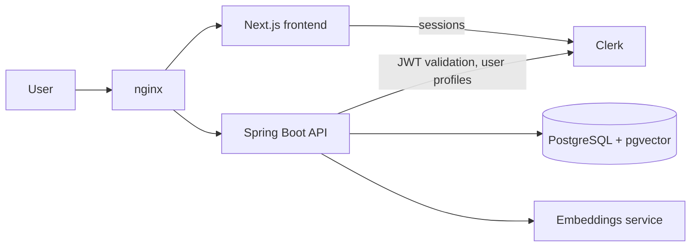

# Wiki 

Intelligent knowledge management platform for technical documents, commercial
documents and procedures, with semantic search, role-based access control and a
change history for every document.

## Features

- **Three document types**: technical documents (content, code snippet, git
  reference), commercial documents (proposal text, client) and procedures
  (description, visual model).
- **Semantic search**: documents are split into chunks, embedded with
  `BAAI/bge-small-en-v1.5` and searched by vector similarity (pgvector).
- **Role-based access control** with four roles: `DEVELOPER`, `SALES`,
  `MANAGER`, `ADMIN`, enforced in the proxy, in the pages and in the API.
- **User management for admins**: new users start without a role and wait for
  approval; an admin assigns a role, or invites a person by email with the role
  already set.
- **Document history**: every create, edit and delete is recorded (who, when,
  which fields, version) and shown on each document page.

## Architecture



The backend follows a layered layout under `backend/src/main/java/org/example`:

| Package | Role |
|---|---|
| `interfaces` | REST controllers, request/response DTOs, exception handler |
| `application` | Services and gateway interfaces (use cases) |
| `domain` | Domain models and enums |
| `infrastructure` | JPA entities, repositories, mappers, gateways, security config |

## Tech stack

- **Frontend**: Next.js 16 (App Router), React 19, TypeScript, Tailwind CSS 4,
  Clerk for authentication
- **Backend**: Java 21, Spring Boot 3.5, Spring Security (OAuth2 resource
  server), Spring Data JPA / Hibernate, Bean Validation
- **Data**: PostgreSQL with the pgvector extension
- **Embeddings**: Hugging Face text-embeddings-inference (`BAAI/bge-small-en-v1.5`)
  in production, the Hugging Face inference API for local development
- **Delivery**: Docker, GitHub Actions, Amazon ECR, AWS Systems Manager, EC2,
  nginx

## Roles and permissions

| Permission | DEVELOPER | SALES | MANAGER | ADMIN |
|---|:-:|:-:|:-:|:-:|
| View technical documents | Yes | Yes | Yes | Yes |
| Create / edit technical documents | Yes | No | Yes | Yes |
| Delete technical documents | No | No | No | Yes |
| View commercial documents | Yes | Yes | Yes | Yes |
| Create / edit commercial documents | No | Yes | Yes | Yes |
| Delete commercial documents | No | No | No | Yes |
| View procedures | Yes | Yes | Yes | Yes |
| Create / edit procedures | Yes | No | Yes | Yes |
| Delete procedures | No | No | No | Yes |
| Semantic search | Yes | Yes | Yes | Yes |
| Manage users | No | No | No | Yes |

Permissions are role-based, not ownership-based: a developer can edit any
technical document, not only their own. The document history is the
accountability counterpart of that rule.

### How access is enforced

1. **Clerk and `proxy.ts`**: the session carries the role; the proxy normalizes
   it and guards protected routes. Users without a valid role are sent to
   `/pending`.
2. **Next.js pages and components**: Create, Edit and Delete controls are shown
   from the role (`lib/auth/roles.ts`), and server-rendered pages redirect
   unauthorized users.
3. **Spring Security**: the API validates the Clerk JWT and checks the role
   with `@PreAuthorize`. This is the real authorization boundary. Any request
   without a valid role is rejected by default.

### Assigning roles

```
Sign up ──► no role ──► /pending ("waiting for access")
                              │
Admin opens /admin ──► picks a role  (or invites an email with a role)
                              │
Next session token carries the role ──► access granted
```

The role is stored in the Clerk `publicMetadata.role` field. The first admin
must be set once in the Clerk dashboard: `{"role": "ADMIN"}`.

## Run locally

Prerequisites: Docker, a PostgreSQL database with the pgvector extension
(`CREATE EXTENSION vector;`), a Clerk application and a Hugging Face token.

```bash
cp .env.api.example .env.api          # backend settings
cp frontend/.env.example frontend/.env  # frontend settings
docker compose --env-file frontend/.env up --build
```

The frontend is on http://localhost:3000 and the API on http://localhost:8080.

### Running the backend and frontend without Docker

Creating or editing a document computes its embeddings, so the backend needs an
embeddings service even when you do not use the search. Start only that service
in Docker, and run the backend and the frontend normally:

```bash
docker compose -f docker-compose.embeddings.yml up -d   # http://localhost:8081
```

Then add this line to `backend/.env` and start the backend (IntelliJ or
`mvn spring-boot:run`) and the frontend (`npm run dev`):

```
EMBEDDING_API_URL=http://localhost:8081/embed
```

### Configuration

| Variable | Used by | Purpose |
|---|---|---|
| `DB_URL`, `DB_USERNAME`, `DB_PASSWORD` | backend | PostgreSQL connection |
| `HF_API_TOKEN` | backend | Embeddings through the Hugging Face API |
| `CLERK_SECRET_KEY` | backend, frontend | Clerk Backend API |
| `CLERK_ISSUER_URI` | backend | JWT issuer (defaults to the dev instance) |
| `CORS_ALLOWED_ORIGINS` | backend | Allowed frontend origins |
| `DDL_AUTO` | backend | Hibernate schema mode (`update` by default) |
| `NEXT_PUBLIC_CLERK_PUBLISHABLE_KEY` | frontend | Clerk publishable key |
| `NEXT_PUBLIC_API_URL` | frontend | API URL seen by the browser |

## Deployment

Every push to `main` runs `.github/workflows/deploy.yml`:

1. builds the backend and frontend images and pushes them to Amazon ECR,
2. deploys to an EC2 instance through AWS Systems Manager, running
   `deploy/docker-compose.prod.yml` (nginx, frontend, backend and the
   embeddings service),
3. waits for the health check to pass.

Pull requests and other branches run `.github/workflows/ci.yml` (backend build
and tests, frontend type check and lint).

## Repository layout

```
backend/    Spring Boot API
frontend/   Next.js application
deploy/     production docker-compose and nginx configuration
.github/    CI and deployment workflows
```
